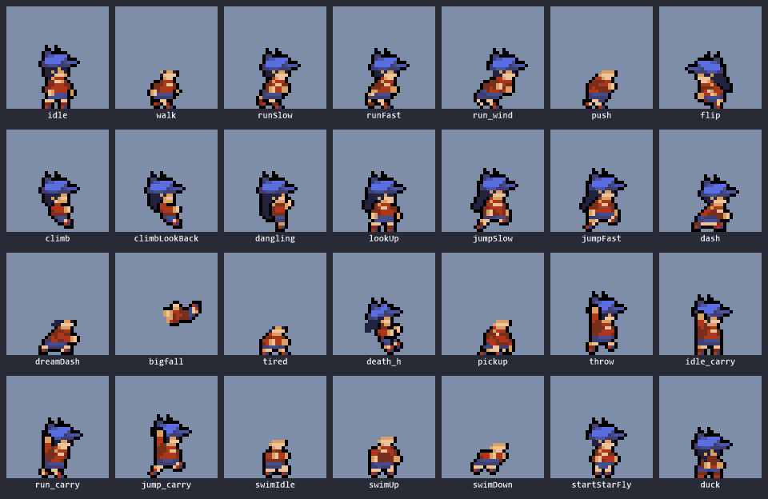
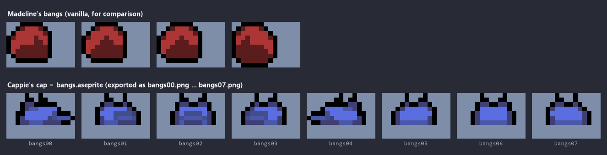
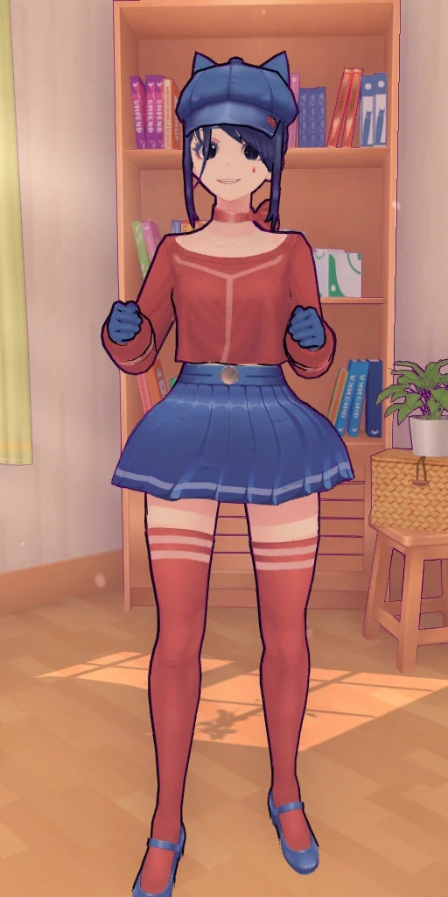

# Cappie Skin for Celeste (unfinished)

A Celeste player skin of **Cappie from MiSide**, made for SkinModHelperPlus. It is **not finished**, and I'm releasing the sources in the hope that someone finishes it.

## The story

About a year ago I decided to try making a skin for Celeste, based on Cappie from MiSide. A couple of months in, I burned out on Celeste, and the skin was left unfinished: about **44% of all frames** are done. Counting only regular gameplay animations (no cutscenes), it's about **84% done**.

I'm not much of an artist, and it got really hard to make myself keep working on it. So I'm releasing Aseprite source files and a list of what's left.

If you're seriously interested in finishing it, contact me (see below). I'm willing to pay for the finished skin.

## What's in here

| File | Contents |
|---|---|
| `aseprite-sources/` | Aseprite files, one per animation. `_palette.aseprite` is the color palette. |
| `reference.webp` | 3D reference of the character. |
| `showcase.gif` | All finished animations at a glance. |
| `bangs.png` | The cap sprites (bangs) next to Madeline's vanilla bangs. |

Most `.aseprite` files have a `Ref` layer (usually hidden) with the original Madeline frames for alignment, and a `Cappie` layer with the drawing.

## Status

**Done** (234 frames): `idle`, `walk`, `runSlow`, `runFast`, `run_wind`, `push`, `flip`, `climb`, `climbLookBack`, `dangling`, `lookUp`, `jumpSlow`, `jumpFast`, `dash`, `dashSkid`, `dreamDash`, `duck`, `bigfall`, `tired`, `death_h`, `pickup`, `throw`, `idle_carry`, `run_carry`, `jump_carry`, `swimIdle`, `swimUp`, `swimDown`, `startStarFly`, `startStarFlyWhite`, `bubble`, `bangs`

**Left: gameplay**

| Animation | Frames | Note |
|---|---|---|
| `launch` | 8 | The file exists, but the `Cappie` layer is still an unedited copy of Madeline |
| `launchRecover` | 10 | |
| `edge` | 14 | |
| `edge_back` | 14 | |

**Left: cutscenes (nice to have)**

| Animation | Frames |
|---|---|
| `idleA` / `idleB` / `idleC` | 12 / 15 / 15 |
| `sleep` | 24 |
| `tentacleGrab` | 26 |
| `walk_carry_theo` | 19 |
| `sitDown` | 17 |
| `spin` | 14 |
| `roll` / `rollGetup` / `rollSit` | 13 / 4 / 1 |
| `fallPose` | 11 |
| `hug`, `shaking`, `halfWakeUp`, `starFly` | 1 each |

## The cap is the bangs

In vanilla Celeste, Madeline's bangs are a separate sprite that the game draws on top of her head. Cappie's cap replaces the bangs, so it lives in `bangs.aseprite`, not in the body sprites.

## Notes for the artist

- **The cap is the bangs, drawn by the game.** It's `bangs.aseprite`, and its color changes with the dash count (set in SkinModHelperPlus's `HairConfig.yaml`), while the hair keeps its color.
- **The cap must not be baked into body sprites.** In `idle_carry`, `run_carry`, `jump_carry` and `throw` it's already on a separate `Cap` layer. In the other files (`idle`, `runFast`, `lookUp`, `flip`, `death_h`, `startStarFly`, etc.) it's drawn directly on the `Cappie` layer. That's only my sketch to check that the animation looks right, so it needs to be removed or moved to a `Cap` layer before exporting. Where there's no cap in a sprite, it wasn't forgotten: it isn't supposed to be there.
- **Hair is undecided.** Cappie's hair is very thin, and I never decided how to handle it. Some frames have dark blue hair drawn in (`flip`), others don't (`duck`, `run_carry`). That's up to you.
- **No gloves on purpose.** Blue hands would blend into the blue skirt.
- **Design:** blue cap with cat ears, dark navy hair, red choker, red long-sleeve crop top, blue pleated skirt with a light stripe, bare thighs, red thigh-high socks with stripes, blue shoes.

## Exporting

Export each file as a PNG sequence named like vanilla (`runFast00.png`, `runFast01.png`, ...), without the `Ref` and `Cap` layers, and use them in a [SkinModHelperPlus](https://gamebanana.com/mods/473796) skin.

## Rights

You're welcome to finish, modify and publish this skin. Please credit me (Jl4cTuk).

Cappie and MiSide belong to their respective owners. Madeline's frames in the `Ref` layers belong to the makers of Celeste and are included only as an alignment reference.

## Credits

- Jl4cTuk: drawing and setup
- kuksa (kuksattu) and AAA1459 (aaa1459): help with the XML and the documentation

## Contacts

- Steam: https://steamcommunity.com/id/Jl4cTuk/
- Telegram: https://t.me/Jl4cTuk
